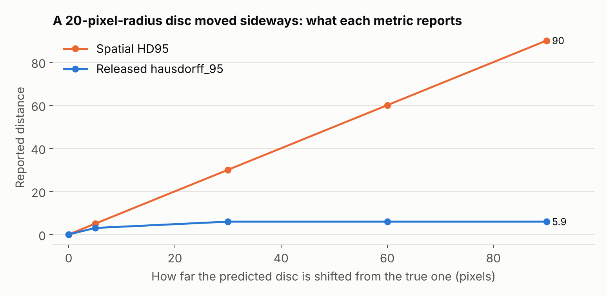

# multiPI-TransBTS: reproduction, audit of the released code, and one proposed change

This repository builds on the official code for

> Zhu et al., *multiPI-TransBTS: A Multi-Path Learning Framework for Brain Tumor Image Segmentation Based on Multi-Physical Information*, arXiv:2409.12167
> Official repository: https://github.com/JoetheReindeer/multiPI_TransBTS

The official history is imported unchanged, so every original commit keeps its author. Everything added for the reproduction is on the `reproduction` branch:

| Path | What it is |
|---|---|
| `repro/audit.py` | Checks of the released split lists, Hausdorff metric and model. Needs no data and no GPU. |
| `repro/prepare_data.py`, `repro/data.py` | The released preprocessing, re-implemented step for step, plus split construction. |
| `repro/train.py`, `repro/losses.py` | Training with the released model, loss and hyper-parameters. Adds mixed precision, resume and logging. |
| `repro/metrics.py` | The released metrics (called from `kits/`) next to standard ones. |
| `repro/make_report.py` | Tables and figures from the saved results. |
| `notebooks/multiPI_TransBTS_colab.ipynb` | The whole pipeline on a free Colab T4. |
| `results/` | Numbers, logs and figures of the runs reported below. |

The original README is preserved as [`README_upstream.md`](README_upstream.md).

## 1. Does the released code run?

Not as published. Four small fixes were needed (the commit "Fix the released code so it runs"):

- `trainer.py` and `test.py` import a package called `data` that does not exist in the repository (the folders are `data2019` and `data2020`).
- `test.py` builds the model with an argument it does not have (`num_classes=3`) and unpacks three outputs where the model returns four.
- `trainer.py` reads `args.ft`, which `train.py` never defines, so resuming crashes.
- The curvature kernel and the BCE loss are hard-coded to `.cuda()`. They now follow the module's device.

No model weights are published, so the paper's numbers can only be approached by retraining.

## 2. What the paper's numbers measure

These three points come from reading and running the released code. Each can be re-checked in under a minute with `python -m repro.audit` (output in `results/audit.json`).

**The train / test split is by slice, not by patient.** The released lists (`data2020/train_list.txt`, `val.txt`, `test_list.txt`) split 24,421 tumour-bearing 2D slices 80 / 10 / 10. All 367 patients that appear in the test list also appear in the training list, and 95.5% of the test slices have a directly adjacent slice (1 mm away, same patient) in the training list. BraTS2019 shows the same pattern (331 of 331 test patients, 94.8% of test slices). A test set of this kind measures interpolation between neighbouring slices of patients the network has already seen, not segmentation of a new patient.

**The reported "HD95" is not a Hausdorff distance in the image.** `kits/metrics.py` passes two whole 224×224 masks to `hausdorff.hausdorff_distance`, a function that expects a list of points with one point per row. Each image row is treated as a 224-dimensional point, and the result is multiplied by 0.95. For a 20-pixel disc moved sideways by 30, 60 or 90 pixels the released function returns 5.9 every time, where the spatial HD95 is 30, 60 and 90 pixels.



**Dice and Sensitivity are pooled over all test pixels**, from one confusion matrix per region, not averaged per patient. Only slices that contain tumour are ever evaluated, because preprocessing drops all other slices. The confusion matrices are also never reset between the validation passes and the final test pass in `trainer.py`.

Smaller differences between paper and code:

- The paper's loss (Eq. 24) has unit weights. The code uses `0.3 * (Dice + BCE / batch_size)` per head.
- The three task decoders share their up-sampling blocks and the final 1×1 output layer. The modules `up11..up23`, `up1`, `up2`, `out1`, `out2` and two stages of the fusion encoder are created but never used: 28.6 M of the 134.0 M parameters never receive a gradient.
- The paper reports two RTX 8000 (48 GB) cards; the upstream README says one RTX A4000.

## 3. What was run here

The paper's setting is 100 epochs at batch 12 over 19,536 training slices (1,628 iterations per epoch) with four PVTv2-B2 branches plus a fusion encoder. That does not fit in a free Colab session (see the measured speed in the results below), so the runs here are **scaled**: a random subset of patients, fewer epochs, everything else as released.

| | Paper | This repository (scaled) |
|---|---|---|
| Data | BraTS2020, 369 patients, 24,421 slices | BraTS2020, subset of the 369 patients (see results) |
| Split | released slice lists, 80/10/10 | the same lists restricted to the subset, **plus** patients never used in training |
| Model, loss, optimiser | released code | released code, unchanged |
| Batch size, lr, schedule | 12, 0.01, poly | 12, 0.01, poly |
| Epochs | 100 | see results |
| Precision | not stated | mixed precision (to fit a 16 GB T4) |
| Metrics | released metrics | released metrics **and** standard ones |

One trained baseline is evaluated twice: on the official test slices of the subset (the paper's protocol) and on patients that were held out entirely. The difference between the two is the effect of the slice-level split.

## 4. Proposed change

The paper notes that enhancing tumour (ET) is its weakest region and that ET sensitivity is not the best among the compared methods. The change tested here targets exactly that and touches one parameter:

- The overlap term of the ET head becomes a Tversky index, `TP / (TP + (1-β)·FP + β·FN)`.
- β = 0.5 is algebraically the released Dice loss, so the baseline is unchanged.
- β = 0.7 penalises missed ET voxels more than false alarms.

WT and TC heads, architecture, data, seed and schedule are identical between the two runs (`--et_beta 0.5` vs `--et_beta 0.7`).

## 5. Results

The numbers, training logs and figures of the Colab runs are written to `results/` by the notebook:
`results/summary.md` (tables), `results/<run>/results.json` (everything, including per-epoch history) and `results/figures/`.

<!-- RESULTS -->
*The scaled baseline and variant runs have not been added to this branch yet.* `results/audit.json` (section 2) is already here.
<!-- /RESULTS -->

## 6. Run it

**Colab (recommended):** [open the notebook in Colab](https://colab.research.google.com/github/mrm2025011LK/multiPI-TransBTS/blob/reproduction/notebooks/multiPI_TransBTS_colab.ipynb), choose a T4 GPU runtime, run all cells. `PRESET = "scaled"` fits one free session; `PRESET = "full"` is the paper's setting.

**Locally:**

```bash
pip install -r requirements-colab.txt            # plus torch, timm, einops, scipy, matplotlib
wget -P networks/pretrained_pth https://github.com/whai362/PVT/releases/download/v2/pvt_v2_b2.pth

python -m repro.audit                            # no data needed
python -m repro.prepare_data --raw /path/to/BraTS2020_TrainingData --out prep --n_subset 80 --n_heldout 30
python -m repro.train --prep_dir prep --out results/baseline --n_subset 80 --n_heldout 30 --epochs 15 --amp
python -m repro.train --prep_dir prep --out results/variant_et_beta0.7 --n_subset 80 --n_heldout 30 --epochs 15 --amp --et_beta 0.7
python -m repro.make_report --baseline results/baseline --variant results/variant_et_beta0.7
```

Leave out `--n_subset` / `--n_heldout` and use `--epochs 100` for the full setting.

## 7. Limits

- The runs here are scaled (subset of patients, fewer epochs, one seed). Small differences between two runs are within noise.
- Evaluation is on 2D slices that contain tumour, as in the released code. Whole-volume, per-patient 3D metrics that include tumour-free slices are the obvious next step.
- Mixed precision is a deviation from the paper, made to fit a 16 GB GPU.
- The official repository has no licence file. Its history and attribution are kept here; the original authors hold the rights to their code.
